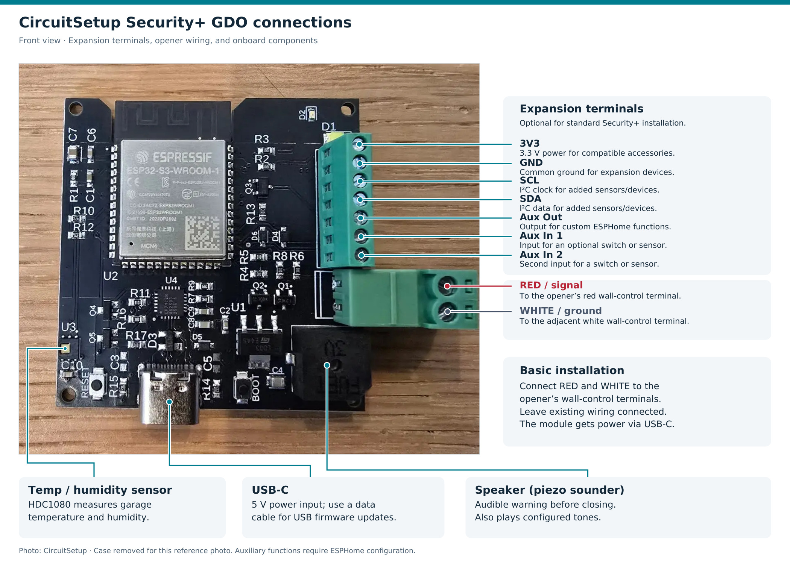
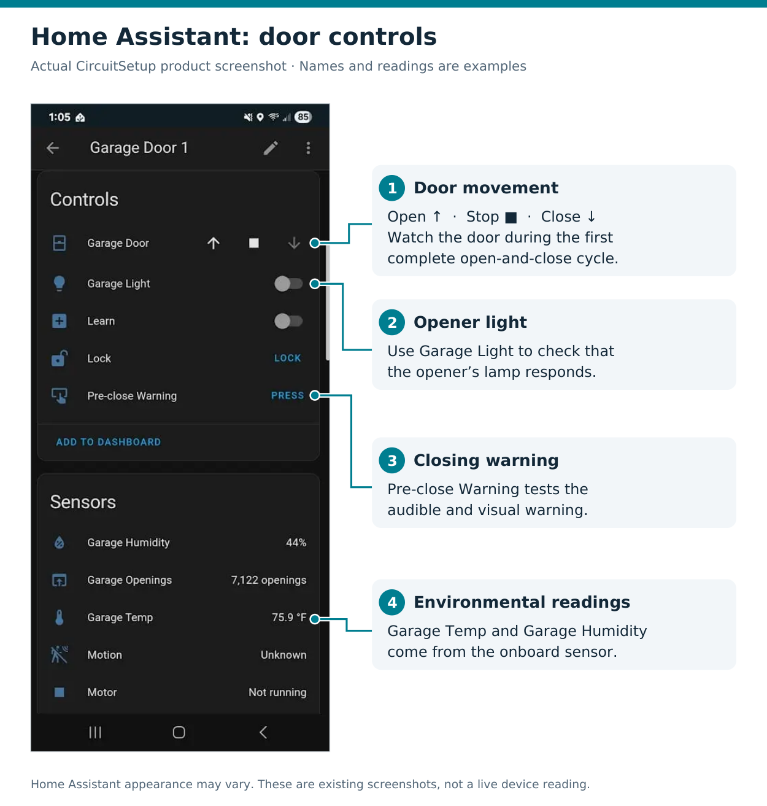
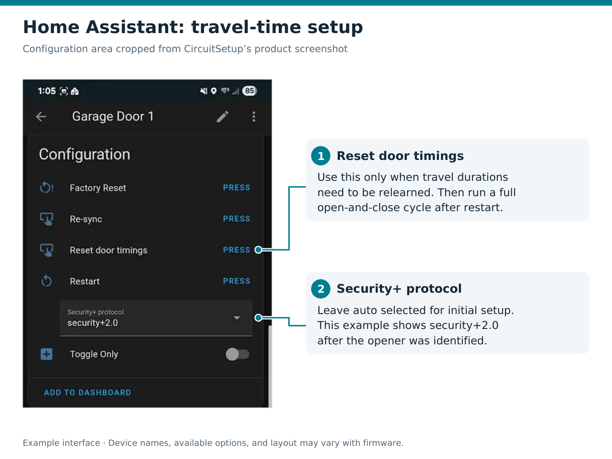
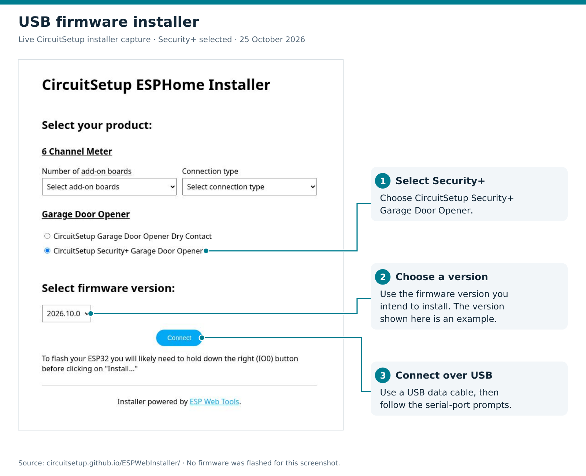

# CircuitSetup Security+ GDO

Install the **CircuitSetup Security+ Garage Door Opener** and connect it to Home Assistant for local door control, door status, opener light control, and garage temperature and humidity readings.

**The module ships with ESPHome firmware installed.** Start with the installation steps below. Flashing firmware or editing YAML is optional for initial setup.

[Product and hardware installation](https://circuitsetup.us/product/security-garage-door-opener/) · [Firmware installer](https://circuitsetup.github.io/ESPWebInstaller/) · [Report an issue](https://github.com/CircuitSetup/circuitsetup-esphome/issues)

## Installation

1. [Check compatibility and gather supplies](#1-check-compatibility-and-gather-supplies)
2. [Connect the module to your opener](#2-connect-the-module-to-your-opener)
3. [Connect to Wi-Fi](#3-connect-to-wi-fi)
4. [Add the GDO to Home Assistant](#4-add-the-gdo-to-home-assistant)
5. [Test operation and learn door travel times](#5-test-operation-and-learn-door-travel-times)

Already installed? See [everyday controls](#everyday-controls), [firmware updates](#firmware-updates-and-usb-installation), [ESPHome configuration](#optional-esphome-configuration), or [troubleshooting](#troubleshooting).

### 1. Check compatibility and gather supplies

This guide covers the CircuitSetup module with **Security+ or Security+ 2.0** openers from Chamberlain, LiftMaster, Craftsman, and Merlin. CircuitSetup lists yellow, red, and purple learn-button models as compatible. Check your opener's model and manual if you are unsure which protocol it uses.

For an opener controlled by a simple dry-contact wall button, use the separate [dry-contact setup and calibration guide](docs/dry-contact.md).

You will need:

- A CircuitSetup Security+ GDO module.
- A **5 V USB power adapter** and USB-C cable.
- Two short lengths of **18–20 AWG wire**.
- Double-sided tape or Velcro for mounting.
- A 2.4 GHz Wi-Fi network with coverage at the opener.
- Home Assistant on a network that can reach the GDO.



*Front-view hardware reference. Each connection and onboard component is labeled with its purpose. The case is removed so the connectors are visible; expansion terminals are optional for standard Security+ installation.*

### 2. Connect the module to your opener

1. Unplug the opener and disconnect power from the CircuitSetup module before wiring. If the opener has battery backup, follow its manual to disconnect that too.
2. Mount the enclosed module near the opener or wall control, within reach of USB power.
3. Identify the opener's **wall-control terminals**, normally red and white. Connect them as shown below.
4. Leave the existing wall-control and safety-sensor wiring connected.
5. Power the module from the 5 V adapter through USB-C, then restore opener power.

| CircuitSetup connection | Opener connection |
| --- | --- |
| Signal / red | Red wall-control terminal |
| GND / white, marked by a white box on the case lid | White wall-control terminal next to red |

Use the opener's terminal labels and manual to identify the wall-control pair. The two control wires carry communication; the module receives power through USB-C. Security+ reads door and obstruction status over this connection, so a separate door-position sensor is not needed.

### 3. Connect to Wi-Fi

1. Power on the module and allow up to a couple of minutes for the setup hotspot to appear.
2. On your phone or computer, join the temporary network named something like **`circuitsetup-gdo-xxxxxx`**.
3. Open the setup page. If it does not open automatically, visit **[http://192.168.4.1/](http://192.168.4.1/)** while connected to that hotspot.
4. Select or enter your home Wi-Fi network, enter its password, and save.
5. Reconnect your phone or computer to your normal network after the GDO joins Wi-Fi.

The setup hotspot is a fallback when the module cannot connect to Wi-Fi. If you already configured Wi-Fi, look for the device on your router or in Home Assistant instead.

### 4. Add the GDO to Home Assistant

1. Open **Settings → Devices & services** in Home Assistant.
2. Find the discovered ESPHome device and select **Configure** or **Add**.
3. Complete the setup and assign the device to your garage area.

If discovery does not appear, select **Add integration → ESPHome**, enter the GDO's IP address from your router, and use the default API port **6053**. If you enabled API encryption in a custom configuration, enter that device's encryption key when prompted.

The Home Assistant ESPHome integration provides the controls and sensors. **ESPHome Device Builder is only needed if you want to compile, customize, or manage firmware yourself.** See the [Home Assistant ESPHome integration guide](https://www.home-assistant.io/integrations/esphome/) for connection details.

You can also open **`http://<device-ip>/`** in a browser on your local network to access the device's web interface.



*After adding the GDO, open its device page to find these controls. This is a published CircuitSetup example; device names, readings, and Home Assistant appearance may differ.*

### 5. Test operation and learn door travel times

Keep the doorway clear and watch the door throughout these checks.

1. Check that **Synced** reports a connection to the opener. The default **Security+ protocol** setting is `auto`.
2. Use the wall control to place the door fully closed.
3. Open **Garage Door** in Home Assistant and let it reach the fully open position without interruption.
4. Close it and let it reach the fully closed position. The default firmware flashes the warning LED and sounds the buzzer for **5 seconds before closing**.
5. Confirm that the displayed state follows the door, **Stop** works during movement, and **Garage Light** controls the opener's light.
6. Check the opener's safety sensors using the test procedure in its manual, and confirm that the existing wall control and remotes still work.

The Security+ firmware learns and saves opening and closing durations from complete travel cycles. Run a full open-and-close cycle before using partial-position controls. Intermediate positions are estimated from travel time; available feedback depends on the opener.

If travel times later need to be relearned, press **Reset door timings**, wait for the GDO to restart and synchronize, then repeat the full cycle.



*Travel-time and protocol settings. Leave the protocol at **auto** for initial setup; the example shows **security+2.0** after detection. The image is cropped to the configuration section.*

## Everyday controls

The standard configuration exposes these controls and readings. Some depend on features supported by your opener or wall panel.

| Control or reading | Purpose |
| --- | --- |
| **Garage Door** | Open, close, stop, and request a partial opening. |
| **Garage Light** | Control the opener's light. |
| **Lock** | Control the opener's wireless-remote lockout. This is not a physical door lock. |
| **Synced** | Check communication with the opener. |
| **Obstruction**, **Motor**, **Wall Button**, **Wireless Remote**, **Motion** | Monitor opener activity and state. Motion depends on support from the opener or wall panel. |
| **Garage Temp**, **Garage Humidity** | Read the module's onboard environmental sensor. |
| **Garage Openings**, paired-device counts, **Battery** | View additional diagnostics when supported by the opener. |

The device also exposes Wi-Fi signal, IP address, uptime, and firmware information for troubleshooting.

## Firmware updates and USB installation

### Update an adopted device over Wi-Fi

If the device is managed in **ESPHome Device Builder**, open its configuration, choose **Install**, and select the wireless upload option. Keep the existing API encryption key and OTA password when editing an adopted configuration.

Compiling the supplied packages requires **ESPHome 2026.6.0 or newer**. Updating Home Assistant alone does not update ESPHome Device Builder.

### Install or recover firmware over USB

Use this route when you need to reinstall the standard firmware or recover a device that cannot be reached over Wi-Fi.

1. Connect the GDO to your computer with a **USB data cable**.
2. Open the [CircuitSetup ESP Web Installer](https://circuitsetup.github.io/ESPWebInstaller/) in a desktop browser that supports Web Serial, such as Chrome or Edge.
3. Select **CircuitSetup Security+ Garage Door Opener** and the firmware version you want to install.
4. Connect to the module's serial port and follow the installer prompts.
5. After installation, configure Wi-Fi through the installer if offered, or use the [setup hotspot](#3-connect-to-wi-fi).



*USB installation: select **CircuitSetup Security+ Garage Door Opener**, choose a firmware version, then select **Connect**. Captured October 25, 2026; the available versions may change.*

Choose the **Security+** product for the wiring described in this guide. The installer also offers a separate **Dry Contact** firmware.

If no serial port appears, try another data cable or USB port and close any other application using the serial connection. A cable that supplies power may still lack data connections.

## Optional ESPHome configuration

The packaged configuration already includes the correct ESP32-S3 settings, CircuitSetup pin mappings, warning LED, buzzer, temperature/humidity sensor, and Security+ component.

### Import the standard configuration

In ESPHome Device Builder, adopt the discovered device if offered. To create a configuration manually, start with this YAML:

```yaml
substitutions:
  name: garage-gdo
  friendly_name: Garage Door Opener

packages:
  circuitsetup.secplus-garage-door-opener: github://CircuitSetup/circuitsetup-esphome/circuitsetup-gdo-default.yaml@master

wifi:
  ssid: !secret wifi_ssid
  password: !secret wifi_password

api:
  encryption:
    key: !secret garage_gdo_api_key

ota:
  - id: !extend circuitsetup_ota
    password: !secret garage_gdo_ota_password
```

Add the referenced values to your ESPHome **`secrets.yaml`**:

```yaml
wifi_ssid: "YOUR_WIFI_NETWORK"
wifi_password: "YOUR_WIFI_PASSWORD"
garage_gdo_api_key: "REPLACE_WITH_A_GENERATED_BASE64_API_KEY"
garage_gdo_ota_password: "REPLACE_WITH_YOUR_OTA_PASSWORD"
```

Use an actual **32-byte base64 encryption key**, generated by ESPHome Device Builder or the generator in the [ESPHome API documentation](https://esphome.io/components/api/#configuration-variables). The example text is a placeholder. For an already adopted device, preserve its existing credentials.

The `!extend circuitsetup_ota` entry adds a password to the OTA component supplied by the package. See [ESPHome package overrides](https://esphome.io/components/packages/#extend) for details.

Validate the configuration, then install it. For a new or erased board, use USB for the first upload; a reachable device with working ESPHome firmware can be updated wirelessly.

### Customize names and the closing warning

Merge any changes into the existing `substitutions:` block in your device's local YAML:

```yaml
substitutions:
  name: shop-gdo
  friendly_name: Shop Door Opener
  garage_door_cover_name: Shop Door
  garage_light_name: Shop Light
  garage_openings_name: Shop Openings
  garage_temp_name: Shop Temperature
  garage_humidity_name: Shop Humidity
  garage_door_close_warning_duration: 8s
  temp_update_interval: 30s
```

The device name uses lowercase letters, numbers, and hyphens. A unique MAC suffix is appended by default.

For logging and Wi-Fi behavior, use the actual configuration sections in your local YAML:

```yaml
logger:
  level: INFO
  logs:
    api: INFO

wifi:
  power_save_mode: NONE
```

Merge these into existing sections; keep your Wi-Fi credentials. The standard package already uses `power_save_mode: NONE`.

All available substitutions are listed in [the full Security+ configuration](circuitsetup-secplus-garage-door-opener.yaml). Keep the hardware pin mappings unchanged for CircuitSetup boards.

## Troubleshooting

| Problem | What to check |
| --- | --- |
| Setup hotspot does not appear | Allow up to a couple of minutes after power-up. Check USB power. If the GDO already has valid Wi-Fi settings, find its IP address on your router instead. |
| Phone connects to the hotspot but no setup page opens | Stay connected even if the phone reports no internet, then open `http://192.168.4.1/` manually. |
| Home Assistant does not discover the GDO | Confirm it joined Wi-Fi and is reachable from Home Assistant. Add the ESPHome integration manually using the device's IP address. |
| Device is online but **Synced** is off or the door does not respond | With power disconnected, check the red/signal and white/GND connections to the wall-control terminals. Confirm that Security+ firmware is installed. Start with protocol `auto` and inspect the logs if synchronization still fails. |
| Closing is delayed | The default 5-second audible and visual warning runs before a close command. |
| Partial opening is inaccurate | Use **Reset door timings**, then run an uninterrupted full open-and-close cycle. |
| Temperature, motion, battery, or other readings are missing | Temperature/humidity come from the onboard sensor; check logs for sensor errors. Motion, battery, and other opener diagnostics depend on the attached opener and wall panel. |
| ESPHome rejects `flash_mode` or reports an unsupported version | Update ESPHome Device Builder to **2026.6.0 or newer**, then validate again. |
| USB installer cannot connect | Use a data-capable cable, select the correct serial port, and close other serial tools. |

Use **Restart** for a normal reboot. **Re-sync** creates a new Security+ client ID and resets its rolling code; **Factory Reset** clears stored device settings. These are recovery actions, so try the wiring and connectivity checks first.

When [reporting an issue](https://github.com/CircuitSetup/circuitsetup-esphome/issues), include the opener model, learn-button color, GDO firmware version, ESPHome version if you compile it yourself, **Synced** state, and relevant logs. Remove Wi-Fi passwords, encryption keys, and other credentials.

## Advanced configuration and other hardware

- [Full Security+ YAML](circuitsetup-secplus-garage-door-opener.yaml): reference for the standard package and its settings.
- [Custom `secplus_gdo` component](components/secplus_gdo/README.md): direct component use and local development.
- [Dry-contact setup and calibration](docs/dry-contact.md): separate firmware, wiring, calibration, and operating limitations for dry-contact openers.
- [Case files](hardware/): printable enclosure files.

For package-level changes, such as removing the temperature sensor, use a local copy of the full configuration and adjust its package list. Local component edits also require changing `external_components` to the local source described in the component guide.

## Credits and license

This project builds on the open-source garage door work from [Konnected](https://github.com/konnected-io/konnected-esphome), including `secplus_gdo` and `gdolib`, and the earlier work of [ratgdo](https://github.com/ratgdo).

See [LICENSE](LICENSE) and the notices in individual source files.
