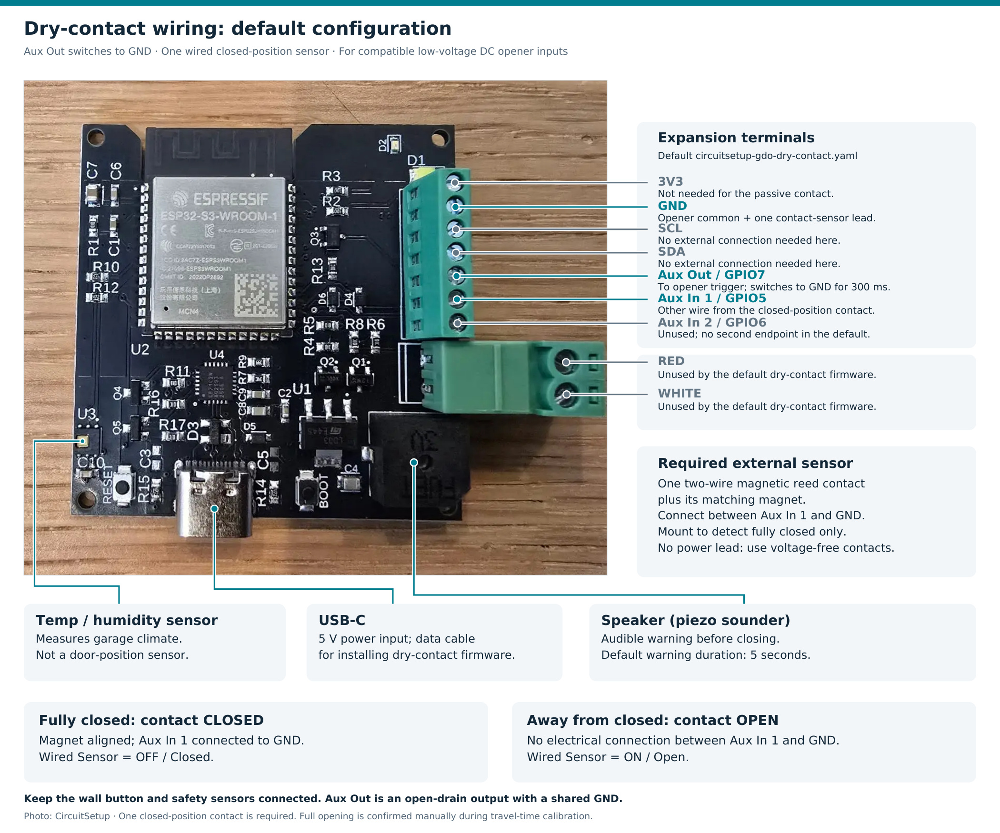

# Dry-contact setup and calibration

This guide applies to [`circuitsetup-gdo-dry-contact.yaml`](../circuitsetup-gdo-dry-contact.yaml), the separate dry-contact firmware. For Security+ or Security+ 2.0 installation, return to the [main installation guide](../README.md).

## Wiring and required sensor

The default dry-contact firmware `1.2` requires **one wired contact sensor at the fully closed door position**, connected between **Aux In 1 and GND**. Use a **two-wire, voltage-free magnetic reed/contact sensor with a matching magnet**. A wide-gap model intended for garage doors is suitable when installed within its specified alignment and operating gap.

Mount the wired contact on the fixed frame or track and the magnet on the moving door. Align them so the contact is electrically **closed only when the door is fully closed** and opens as the door leaves that position. Verify this behavior with a continuity meter; choose by the actual contact behavior rather than relying only on a supplier's NO/NC label. The contact does not need a power connection.

### Connect the opener and position contact

Aux Out is an **open-drain output**: GPIO7 drives MOSFET Q3, which pulls Aux Out to the module's GND for the default **300 ms** button press. Use it with a compatible low-voltage DC opener input that is activated by connecting its wall-button/trigger terminal to its common terminal. The output shares the module's ground; it is not an isolated relay contact.

1. Disconnect power from the opener and module before wiring, including the opener's battery backup if fitted.
2. Connect **Aux Out** to the opener's **wall-button/trigger input**.
3. Connect **GND** to the opener's **common/ground terminal**. Identify these terminals from the opener's manual; this connection is polarity-sensitive.
4. Connect the two leads of the closed-position contact between **Aux In 1 and GND**. This GND connection is shared with the opener common. Use a suitable connector and pigtail if needed to join the ground wires.
5. Leave the existing wall button and the opener's safety/obstruction sensors connected.
6. Supply the module with **5 V through USB-C**, restore opener power, and verify the contact states below before calibrating.

Use an appropriate isolating interface if the opener requires an AC or floating contact input. The **RED/WHITE Security+ connector is unused in this dry-contact setup**.

*Default dry-contact wiring reference. Aux Out switches the opener's compatible DC trigger input to the shared GND. One passive contact detects the fully closed door position.*

| Terminal or connection | Default dry-contact use |
| --- | --- |
| **Aux In 1 / GPIO5** | One lead from the closed-position contact. |
| **GND** | Opener common and the other lead from the position contact. Either lead of a simple two-wire reed contact can be used. |
| **Aux Out / GPIO7** | Connect to the opener's compatible DC wall-button/trigger input. Q3 pulls the terminal to GND for the default 300 ms press. |
| **Aux In 2 / GPIO6** | Unused by the default door-control configuration. Adding a second contact here does not automatically provide fully-open detection. |
| **3V3, SCL, SDA** | No external connection is needed for the passive closed-position contact. |
| **RED / WHITE** | Not used by the default dry-contact firmware. |
| **USB-C** | Separate 5 V power for the module; use a data cable when installing firmware. |

The required input behavior is:

| Door position | Contact between Aux In 1 and GND | Expected **Wired Sensor** state |
| --- | --- | --- |
| Fully closed, magnet aligned | Electrically closed / continuity | **OFF / Closed** |
| Away from fully closed | Electrically open / no continuity | **ON / Open** |

The input uses a pull-up with no inversion and a 200 ms debounce. Check both states in Home Assistant or the device's web page before starting calibration. With the contact open, Aux In 1 should rise to approximately 3.3 V relative to GND; with the contact closed, it should be near 0 V. If **Wired Sensor** remains OFF with the contact disconnected, resolve the input wiring or hardware issue before calibrating.

A mechanical limit switch also works if it provides the same closed-at-fully-closed behavior. A wireless contact or tilt sensor is not a replacement for this wired input in the default configuration.

Keep the opener's existing safety/obstruction sensors connected to the opener. They serve a different purpose from the closed-position contact. The onboard temperature/humidity sensor measures garage climate and does not detect the door position.

Only one position contact is used by default. You can move that input to **Aux In 2 / GPIO6** by overriding `wired_sensor_pin: GPIO6`; this moves the single input rather than enabling two endpoints. The spare auxiliary input can be separately configured for other uses. Fully-open position is confirmed manually during the calibration procedure below, then estimated from travel time during normal operation.

Use the **CircuitSetup Garage Door Opener Dry Contact** firmware option in the [web installer](https://circuitsetup.github.io/ESPWebInstaller/). Follow the [USB installation steps](../README.md#install-or-recover-firmware-over-usb), selecting the dry-contact product for this wiring.

Configuration references: [default pin mappings](../circuitsetup-gdo-dry-contact.yaml), [wired input](../packages/garage-door-wired-sensor.yaml), and [momentary output](../packages/garage-door-opener-button.yaml).

## Calibrate travel times

The device exposes **Calibrate Travel Times**, **Travel Time Calibrated**, and
**Travel Time Calibration** in Home Assistant and its ESPHome web page. The last
two show whether setup is complete and the current step. **Calibrated Opening
Time** and **Calibrated Closing Time** show the saved measurements in seconds.
Normal Open, Close, and Toggle controls cannot move an uncalibrated door.

Calibrate while watching the door and keeping the doorway clear:

1. Use the wall control to put the door fully closed and let it stop. Press
   **Calibrate Travel Times**. This deliberate calibration action starts opening
   even though ordinary movement controls are locked.
2. Press the same button again **immediately when the door reaches fully open**.
   The single closed contact cannot detect this endpoint, so this confirmation
   records the opening time. The device then gives its normal closing warning.
3. The device starts closing and measures until the closed contact confirms
   arrival. **Travel Time Calibrated** turns ON and the status reads **Calibrated**.
   Both times are saved together and survive a restart; no YAML time edits are
   required.

**Stop** cancels calibration and remains available during calibration movement.
Ordinary Open, Close, and Toggle requests are ignored throughout the calibration
cycle. Recalibrating clears the old saved times before its first movement. An
interrupted cycle, failed save, or missing endpoint confirmation keeps normal
controls locked, including after a restart. To retry, use the wall control to
return fully closed, then press the calibration button again.

Each measured direction must take at least 2 seconds and less than 120 seconds.
After a two-minute timeout the device cancels pending work and reports failure;
it does not send a blind pulse that might restart a door already at its limit.
Use the wall control if physical movement needs to be stopped after a timeout.

The firmware estimates movement and partial position from the learned times; it
reports fully closed only when the contact confirms it. The opener must stop
itself at its normal travel limits. No automatic output pulse is sent when a
normal travel timer expires. Pressing the full-open confirmation late inflates
the opening estimate, so watch the door closely during calibration.

This configuration assumes a wall-button sequence of **open → stop → close →
stop → open**. A directional request that would send the door the wrong way is
ignored and logged. Stop followed by Toggle reverses the next movement; any
movement toward closed gets the warning first. Openers that reverse immediately
on a press while closing need a different control sequence and are not supported
by this configuration.

Stop remains effective after an opening door leaves the closed contact. Repeated
Open/Close requests do not add another output pulse or restart an active countdown.
Stop or Toggle cancels a pending close, and Toggle during movement stops it without
waiting through another warning. Open also cancels a pending close. An old warning
timer cannot silence a newer warning. If the contact closes during the countdown,
the controller cancels the close without pulsing the opener.

A Stop arriving while the output is still active waits for the current 300 ms press
(or your configured momentary duration) and a 100 ms release gap. New movement
commands during this short interval are ignored; send them after the press ends.

One contact cannot detect an external wall-button stop, an obstruction reversal,
or full opening. Start or reboot with the door stationary at a travel limit; an
inactive closed contact is initially treated as open. After external intervention,
use the wall control to return the door fully closed to synchronize the controller.
Do not rely on its travel estimate as obstruction or motor feedback.

After installing, verify both auxiliary-input choices as applicable, Stop during
opening, a repeated Close while closing, warning cancellation followed by another
Close, and a closed contact during the warning. These require physical acceptance
testing in addition to the automated tests.
